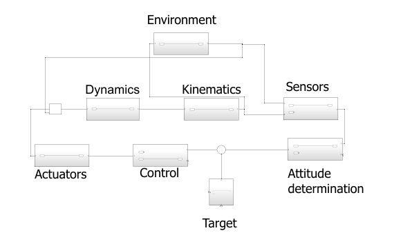
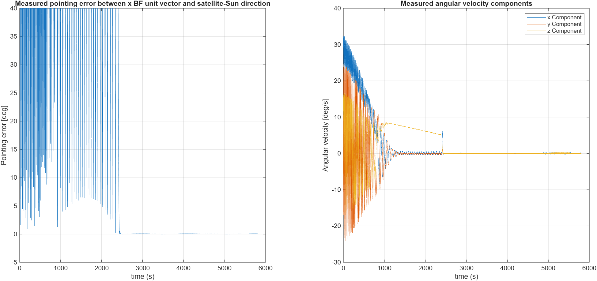
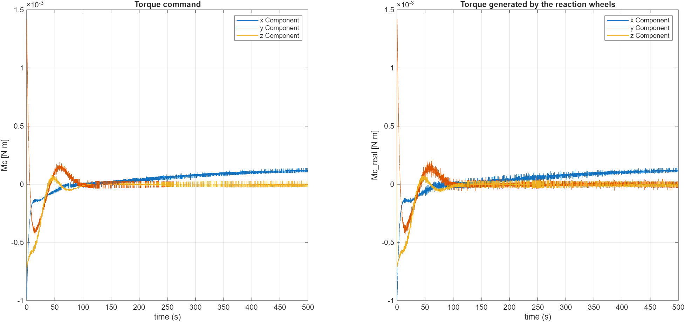
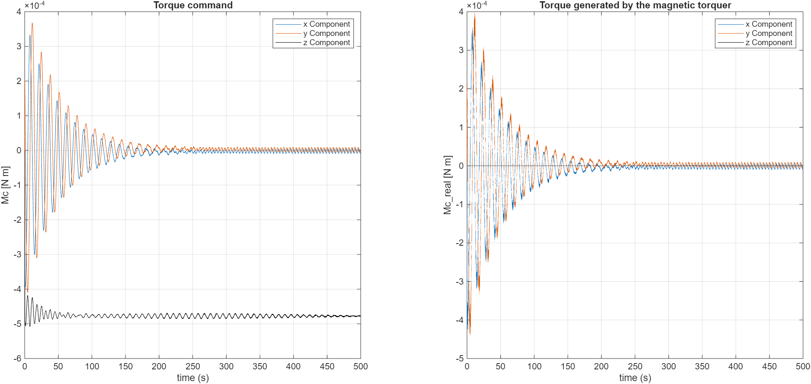

# Attitude Determination and Control of a 6U CubeSat (MATLAB/Simulink)

A Simulink model of the attitude determination and control system (ADCS) of a Sun-pointing 6U CubeSat in low Earth orbit. The model covers detumbling, slew and Sun tracking, using a magnetometer and a Sun sensor for attitude determination and reaction wheels plus a magnetorquer for control.

Group project for the *Spacecraft Attitude Dynamics* course, MSc in Space Engineering, Politecnico di Milano, A.Y. 2025/26.



## Mission and spacecraft

- **Goal:** keep the angle between the body x-axis and the satellite–Sun direction below **5°** during the tracking phase.
- **Spacecraft:** 6U CubeSat, 30 × 20 × 10 cm, 7.23 kg. It is modelled as a uniform box with I = diag(0.0301, 0.0603, 0.0783) kg·m².
- **Orbit:** circular, a = 6978 km (about 600 km altitude), i = 97.8°.
  - The orbit was chosen so that the satellite never enters eclipse.
  - The script checks this with a cylindrical-shadow model.
- **Mission phases:**
  1. Detumbling, starting from a random tumbling rate of 5–40 °/s.
  2. Slew towards the Sun-pointing target frame.
  3. Pointing (tracking) of the target frame.

## What is modelled

| Block | Model |
|---|---|
| Dynamics | Euler's equations for a rigid body |
| Kinematics | Direction cosine matrix (DCM), re-orthonormalised at every step |
| Orbit | Two-body Keplerian propagation of the satellite and of the Earth around the Sun |
| Disturbances | Gravity gradient, plus the magnetic torque from a 0.01 A·m² residual dipole per axis in a spherical-harmonic geomagnetic field. Air drag and solar radiation pressure were estimated and found an order of magnitude smaller than the magnetic torque, so they are neglected. |
| Magnetometer | Non-orthogonality; white, pink and brown noise; 6.5 nT quantisation; ±50 µT saturation; 10 Hz with zero-order hold and a one-sample delay |
| Sun sensor | 0.5° accuracy at 10 Hz, with discretisation and delay |
| Attitude determination | Algebraic two-vector method (magnetometer + Sun sensor). An SVD-based statistical method was also implemented for comparison. Angular velocity is estimated from the DCM by finite differences, since there is no gyroscope. |
| Detumbling control | Rate damping τ = −kω with k = 7·10⁻⁴, using the magnetorquer only, until \|ω\| < 5 °/s |
| Slew and pointing control | State feedback τ = −Kx on attitude error and angular rate, using the reaction wheels only. K is obtained from the Riccati equation (`icare`), with Bryson's-rule weights of 5°, 2 °/s and 10⁻⁴ N·m. Controllability and observability were verified. |
| Reaction wheels | 3 wheels (NewSpace NRWA-T005 datasheet): 0.2·10⁻³ kg·m², 250 rad/s maximum speed, 10 mN·m maximum torque, ±1 rpm speed-measurement error |
| Magnetorquer | 3-axis (NanoAvionics SatBus MTQ datasheet): 0.65 / 0.65 / 0.50 A·m² maximum dipole, ±10 % dipole error |

Several sub-models were validated against known cases:

- Angular momentum and kinetic energy are conserved in torque-free motion.
- The gravity-gradient torque is zero for an LVLH-aligned satellite in an equatorial orbit.
- The geomagnetic field magnitude matches reference values.
- The magnetorquer torque is always perpendicular to the magnetic field.

## Results

Six test cases were simulated over one orbit (5801 s), each with a different initial angular velocity, attitude and true anomaly. In all six:

- tracking starts between about 1100 s and 2500 s;
- the pointing error stays below 5° from the start of tracking until the end of the simulation.

**Case 1** (ω₀ = [0.5, −0.3, 0.2] rad/s): measured pointing error and angular velocity. Tracking starts at about 2500 s.



**Reaction wheels:** commanded torque vs. torque actually produced.



**Magnetorquer during detumbling:** commanded torque vs. torque actually produced. The component parallel to the magnetic field cannot be produced.



The full derivations, validation and all test cases are in the [project report](report/SAD_report.pdf).

## Repository structure

```
├── Initial_condition.m       # main script: parameters, LQR gain, runs the model, plots
├── Complete_SAD_model.slx    # Simulink model (environment, sensors, attitude determination, control, actuators)
├── report/
│   └── SAD_report.pdf        # project report
└── figures/                  # images used in this README
```

## Requirements

- MATLAB and Simulink **R2025b or later** (tested up to R2026a). The model was saved in R2025b, so older releases cannot open it as is.
- Control System Toolbox (`icare`)
- DSP System Toolbox (Lowpass Filter and Normalization blocks)
- Simulink 3D Animation (Normalize Vector block)

## How to run

1. Clone or download this repository.
2. Open MATLAB in the repository folder.
3. Run `Initial_condition.m`. The script:
   - defines all parameters and computes the control gain K;
   - runs `Complete_SAD_model` for one orbital period with a fixed-step `ode4` solver at 0.01 s;
   - prints the eclipse check and opens the result plots.

To try other scenarios, change the initial angular velocity `omega0`, the initial attitude `A_BN_0` or the initial true anomaly `theta` at the top of the script. The random sensor errors use a fixed seed (`rng(1)`), so runs are reproducible.

## Authors

Simone Frescura, Nicola Pifano, Luca Puzzi, Lorenzo Veronese

Politecnico di Milano, *Spacecraft Attitude Dynamics*, A.Y. 2025/26
